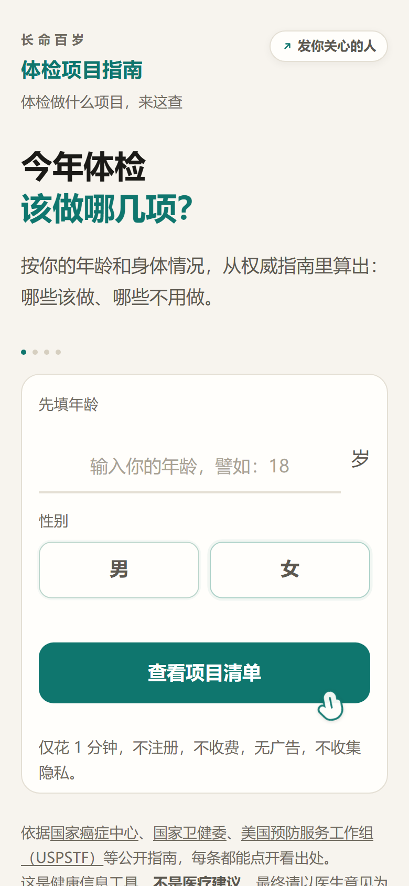
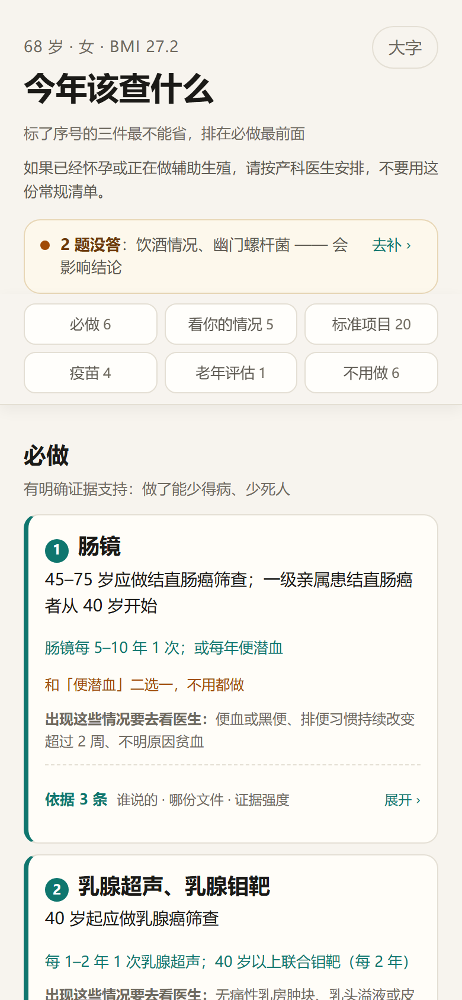
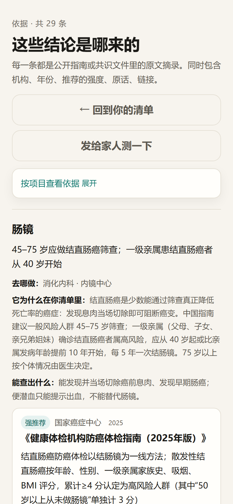
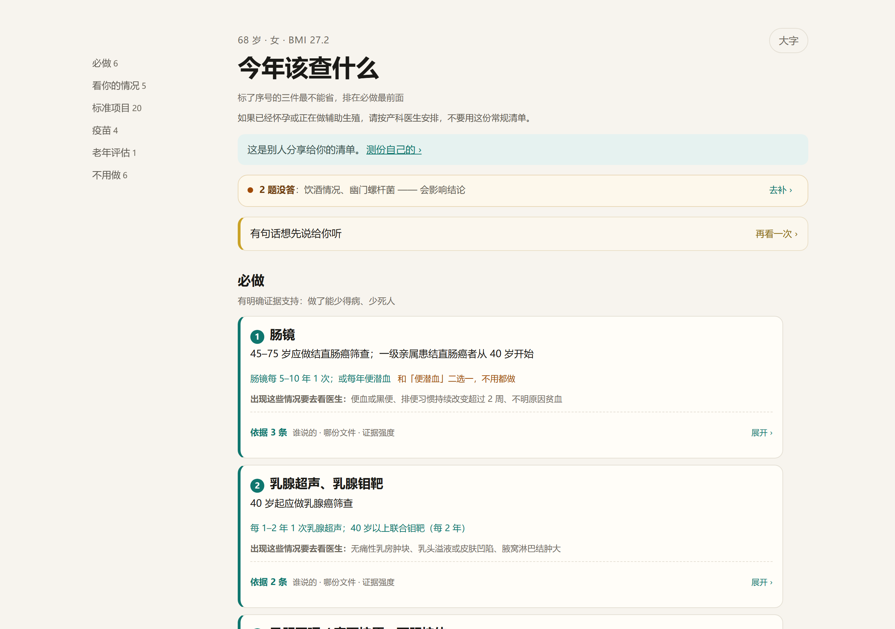

<div align="center">

# 长命百岁 · 体检项目指南

**HowToCheckup — Evidence-based health screening checklist**

### 体检做什么项目，来这查

*按年龄与风险因素，生成"必做 / 看情况 / 不用做"的循证体检清单，每条附指南原文出处。*

[](LICENSE)
[]()


</div>

---

## 这是什么（一句话）

一个**纯静态网页**：填年龄、性别和几道风险题，按**国家卫健委、国家癌症中心、中华医学会各分会、美国预防服务工作组（USPSTF）**的公开指南，生成分档体检清单——**必做 / 看你的情况 / 标准项目 / 不用做**，每一条都能点开看**指南原文摘录**。免注册、无后端、无 Cookie、无统计脚本。

| | | |
|:---:|:---:|:---:|
|  |  |  |
| 一分钟填完 | 分档清单，附依据条数 | 每条结论可查原文 |

## 为什么做它

体检检查项目越来越多，太专业看不懂，该做什么不该做什么，大部分搞不懂：健康人不该做的项目，做了只会带来假阳性和一串复查，浪费时间金钱消耗精力；而真正该做的，很多人不知道自己这个年龄、身体状况该做哪几项。这个产品只做一件事，把"该不该查"翻译成人话，并且每条都有权威依据**每条都能自己核实**。
希望大家好好体检，身心健康，早发现早治疗，别拖延。

- **证据可溯源**：每条结论挂到具体文件的具体段落；`npm run check:research` 会拿每条引文去原文快照里做连续匹配，找不到原句就报错——"摘录"不是"改写"。
- **证据分级**：借用 USPSTF 的 A/B/C/D/I 五级（A/B 建议做，C 看个人情况，D 不建议做，I 证据不足）。
- **老人也会用**：单题单屏、按钮 ≥52px、正文对比度按 WCAG 校验、支持 360px 小屏与系统字体放大。
- **不收集隐私**：画像只以 Base64URL 编码放在网址 `#p=` 片段里，不随请求发给服务器；无 Cookie、无 localStorage、无统计脚本。
- **随指南更新**：43 条筛查规则是纯 JSON 配置，指南更新只改数据不改代码；GitHub Actions 每周巡检指南是否有新版。

## 快速开始

```bash
npm install
npm run dev      # 本地开发
npm run build    # 产出 dist/（纯静态，可部署到任意静态托管 / GitHub Pages）
npm test         # 数据校验 + 单测 + 不变量 + 变异测试 + 真浏览器验收
```

部署：把 `dist/` 上传到任意静态托管即可，无后端、无数据库。

## 质量保障

三条互相独立的检查链，全部通过才算可发布：

| 检查链 | 作用 | 规模 |
|---|---|---|
| 数据校验 | 规则、证据、选项的字段完整性与引用有效性 | 全量 |
| 不变量检查 | 跨文件约束：默认值不得等于选项值、文案与链接不得漂移、署名与头像尺寸一致 | 52 条 |
| 变异测试 | 故意改坏源码，证明每条不变量真的会报警（防止"永远通过"的假检查） | 55 条 |
| 真浏览器验收 | Chrome 无头模式按 iPhone 尺寸跑完整流程，含截图与破版检测 | 219 项 |

桌面端（≥900px）：



## English

**What it is.** A static, privacy-first web tool that turns public clinical guidelines (NHC China, National Cancer Center, Chinese Medical Association branches, USPSTF) into a **personal health screening checklist**: answer a few questions about age, sex and risk factors, get a tiered list of what to screen for this year — *recommended / depends on you / routine / not needed* — with every conclusion linked to the exact passage of the source document.

**Why.** Commercial health-check packages upsell tests that add false positives, not health. This project does the opposite: it says **what NOT to get done**, and shows the evidence for every line.

**Key facts**

- Pure static front end, vanilla JavaScript (no framework), first paint < 100 KB, works in WeChat's built-in browser and Chrome 61+.
- No backend, no database, no cookies, no analytics. The profile lives only in the URL hash.
- 43 screening rules as JSON config, so guideline updates are data edits, not code changes.
- Test system: 52 cross-file invariants, 55 mutation tests proving the guards actually fire, and 219 real-browser checks (iPhone-size headless Chrome).
## 目录

| 路径 | 是什么 |
|---|---|
| `index.html` / `r.html` / `e.html` / `selftest.html` / `404.html` | 5 个页面入口（首页 / 结果页 / 依据页 / 真机自检页 / 404） |
| `src/` | 页面与逻辑（无框架，原生 JS + CSS，17 个模块） |
| `data/rules.json` | 规则库：每条规则 = 条件 + 结论 + 依据（含逐字引文） |
| `data/where.json` | 「去哪个科」一栏的来源与依据类型 |
| `data/snapshots/` | 引文核对用的原文快照（公开网页） |
| `tests/` | 单元测试、变异测试、浏览器端到端用例 |
| `scripts/` | 数据校验、指南巡检、截图、头像压缩等工具 |

## 数据与隐私

- 不注册、不登录、不收费、无广告。
- 画像（年龄、风险因素）编码进网址 hash，**技术上无法被服务器读取**，也不写入本机存储。
- 分享链接给家人，对方打开即得同一份清单；链接里不含任何身份信息。

## 作者

**老王AI瞎bb**

- 小红书 [@老王AI瞎bb](https://www.xiaohongshu.com/user/profile/56fe2edf4775a72b03563fdc)
- GitHub [laowang-ai-xbb](https://github.com/laowang-ai-xbb)

产品首页页脚、结果页与依据页底部都有署名链接，与 [LICENSE](LICENSE) 的版权声明保持一致。

## 许可证

[MIT](LICENSE) —— 允许自由使用、修改、再分发（含商业使用），但须保留版权声明与许可证文本。

## 免责声明

**这不是医疗建议。** 清单依据公开指南自动生成，不能替代医生面诊。已确诊疾病、正在服药、或近期有不适的人，请直接找医生。指南会更新，软件随指南更新而更新。

---

<div align="center">

体检做什么项目，来这查 · What screening tests do I actually need? Check here.

</div>
